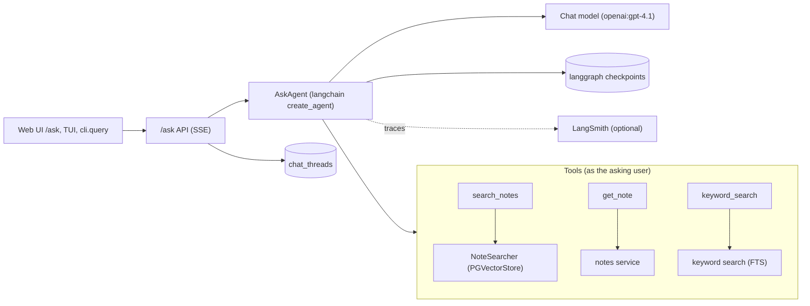

# Ask AI

Users ask questions in natural language and an agent answers from the
notes they can view, citing the notes it used. Conversations are threads
the user can come back to.

Code: `src/assistant/agents/` (agent, tools, tracing),
`src/assistant/chat/` (threads), `src/assistant/api/routes/ask.py` (API).
The embeddings it searches are described in [Vector search](vectors.md).



## Agent

`AskAgent` (`agents/rag.py`) builds a langchain `create_agent` agent for
each question, with the tools bound to the asking user, and runs it with a
`PostgresSaver` checkpointer keyed by the thread id. Earlier turns of the
thread are therefore part of the context. The system prompt asks it to
search before answering, answer only from what the tools return, say so
when the notes don't contain the answer, and name the notes it used.

`stream(thread_id, user_id, question)` flattens the run into events:

| Event | When |
| --- | --- |
| `TokenEvent(text)` | each piece of answer text (from the model node only) |
| `ToolEvent(name, status, input)` | a tool call starts (`input` = its arguments) or ends |
| `SourcesEvent(sources)` | after the answer: every note the tools returned, deduplicated |
| `ErrorEvent(message)` | the run failed; replaces `SourcesEvent` |
| `DoneEvent` | always last |

Failures never raise out of `stream`: they are logged (and so reported to
Sentry) and turned into a user-facing message — no credits left, rate
limited, service unavailable, or a generic error.

`history(thread_id)` reads the checkpoint back as user/assistant messages;
tool calls are hidden and the sources of the tool results are attached to
the answer that followed. `delete_history` deletes the checkpoints.

## Tools

Built per question by `build_tools(session_factory, user_id, searcher)`.
Each call opens its own session, so permission changes apply on the next
call. All return `(content, sources)` (`response_format=
"content_and_artifact"`): the model reads `content`, the sources travel in
the message artifact (and so are stored in the checkpoint).

- **`search_notes(query)`** — semantic search: the closest chunks among the
  notes the user can view (`NoteSearcher.search`, k=6). Each passage starts
  with its `note_id`, title, notebook and section.
- **`get_note(note_id)`** — the whole note as markdown (truncated at 20 000
  characters), if the user holds VIEW_NOTE on it; otherwise "Note not
  found".
- **`keyword_search(query)`** — the keyword search service
  (`assistant.search.service.search`), same syntax as the search box
  (phrases, `tag:`), top 10 notes with snippets.

### Permissions in semantic search

`NoteSearcher` turns `viewable_scope(session, user)` — the notebooks where
the user holds VIEW_NOTES/OWN_NOTES and the notes with a direct VIEW_NOTE
grant — into a langchain metadata filter:

```python
{"$or": [{"notebook_id": {"$in": [...]}}, {"note_id": {"$in": [...]}}]}
```

`PGVectorStore` applies it as a `WHERE` on the chunk table's columns. Its
connections set `hnsw.iterative_scan = strict_order` (pgvector ≥ 0.8), so a
selective filter keeps walking the HNSW index instead of returning fewer
than `k` chunks.

## Threads

`chat_threads(id, user_id, title, created_at, updated_at)` lists each
user's conversations (`chat/service.py`); the messages are the langgraph
checkpoints (tables in the `public` schema, created by
`PostgresSaver.setup()` on first use) under the same id. A thread is
visible to its owner only. The first question becomes the title (one line,
at most 80 characters); asking bumps `updated_at`. Deleting a thread deletes
its checkpoints first, then the row. Deleting a user deletes their thread
rows (their checkpoints are left behind).

## API

See [Ask AI in the API](api.md#ask-ai). Answers are a `POST` returning
`text/event-stream`; the route commits the thread title before streaming,
because the stream outlives the request's session. nginx proxies `/ask/`
without buffering.

## Configuration

```yaml
ai:
  embedding_model: text-embedding-3-small   # AI_EMBEDDING_MODEL
  chat_model: openai:gpt-4.1                # AI_CHAT_MODEL (langchain provider:model)
  # langsmith_project: Assistant            # AI_LANGSMITH_PROJECT
```

- **`OPENAI_API_KEY`** turns AI on. Without it there is no agent, the API
  answers 503, `GET /ask/status` reports `enabled: false` and the web UI
  hides Ask AI.
- **`LANGSMITH_API_KEY`** turns LangSmith tracing on
  (`agents/tracing.configure_tracing`, called by the API app and the CLIs).
  Every run is named `ask`, tagged `ask`, and carries `user_id` and
  `thread_id` metadata.

## Terminal

```bash
# Interactive chat (new thread, or resume one)
python -m assistant.cli.chat --email user@example.com [--thread-id UUID]
# One question, answer on stdout
python -m assistant.cli.query --email user@example.com "What did I plan for Rome?"
```

Both create threads that also show up in the web UI.
