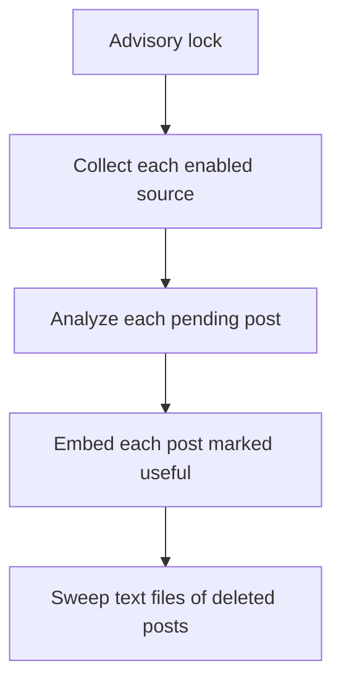

# Blogs

Users register blogs and feeds as sources. A job started from the command line
collects new posts, and the user triages them in the Blogs section. The behaviour
is in the [spec](../specs/0008-blogs.md). Code: `src/assistant/blogs/`.

Nothing is shared: directories and sources have an `owner_id`, posts reach
their owner through the source, and there are no entitlements. A service
function loads the row filtered by owner, so another user's row is a 404.

## Storage

| Table | Content |
| --- | --- |
| `blog_directories` | A user's single-level folders. `name` is unique per user. |
| `blog_sources` | What to collect (`feed_url`, `kind`, `collect_since`), the user's fields, and the last collection (`etag`, `last_modified`, `last_fetched_at`, `last_error`, `consecutive_failures`). Unique on owner and `feed_url` among sources not archived. |
| `blog_posts` | `post_key`, unique per source, metadata and analysis. `status` is the pipeline, `state` the user's verdict, `read_at` when the user marked it read. |
| `post_tags` | Tags on posts, from the same per-user vocabulary as notes. |
| `blog_collection_runs` | The collection log: one row per source each time the job or a refresh reads it. `outcome` is null while the source is read, `finished_at` while its posts are analyzed. The latest 20 per source are kept. |
| `blog_collection_entries` | One row per entry the source listed in a run: link, date, `verdict`, `post_id` (`SET NULL` when the post goes), then the analysis: `text_source`, `text_chars`, outcome, error, and a copy of the model's summary, match level and motivation. |
| `post_chunk_embedding` | Not mapped (Postgres-only, pgvector). One row per chunk of a useful post, same shape as `note_chunk_embedding`, with `post_id`, `source_id`, `owner_id`. HNSW cosine index. No feature reads it yet. |

Deleting a user cascades to all of it.

## Registering a source

`blogs/discovery.py` resolves the URL: as a feed, then a feed advertised with
`<link rel="alternate">`, then the site's sitemap (from `robots.txt`, or at a
well-known path). A page that declares itself an article (`og:type`, JSON-LD),
or that the feed lists as an entry, is a single post and is refused. Errors
are generic and never contain anything from the response.

The request waits for all this, so nginx gives `/blog/` a longer read timeout
(`docker/frontend/nginx.conf.template`). The API is under `/blog/`, and `/blogs`
is the SPA.

## Deleting a source

`DELETE /blog/source/{id}` deletes the source with its posts. With
`keep_useful=true` the source is archived instead: it stops collecting, leaves
the source list, and only its useful posts stay. Its feed can then be
registered again, so a useful post can appear twice, once under each source.

## Evaluating posts

`state` is the user's verdict, and `Relevant` only ever means `useful`: the model's
match level never changes a state or hides a post.

| Change | Effect on `embed_status` |
| --- | --- |
| To `useful` | `pending`; the next job run embeds it |
| Away from `useful` | `none`, and the chunks are deleted in the same transaction |

The list is paged by keyset (a cursor of the sort key), not offset, because
evaluated cards leave the New list while the user scrolls and an offset would
skip the posts after them. All and Relevant sort by `published_at DESC, id DESC`,
New by match rank (high first, unscored last) and then the same.

Posts still `pending`, and `skipped` rows, are never returned and answer 404.

## Read

`PUT /blog/post/{id}/read` with `{"read": true}` sets `read_at`, and `false`
clears it. It never touches `state` or the embeddings, and marking a read post
read again keeps the first time. `GET /blog/post?read=true|false` keeps only
read posts, or only those still to read, in any view.

## Safe fetcher

`blogs/fetch.py` is the only code that opens a URL.

- `http` and `https` only, no credentials in the URL.
- The host is resolved, every address must be public, and the connection goes
  to a validated address, so a second DNS answer can't change the target. TLS
  is verified against the host name.
- Redirects are followed by the fetcher, at most 5, with the same checks on
  each hop.
- 10 s for a whole request and 5 MB of decompressed body.

Fetched content is only parsed as data. Two details matter: `feedparser` gets
a stream, because given a plain value it tries it as a URL or a local path; and
sitemaps are parsed with `defusedxml`, with DTDs refused.

## Post identity

`blogs/identity.py`: `post_key` is the SHA-256 of the guid or, without one or
when the guid is a URL, of the URL path. The domain is ignored, so a blog can
move. Tracking parameters (`utm_*`, `fbclid`, ...) are dropped and any other
query parameter counts, which errs on the side of keeping two posts apart.

## The job

```bash
make process-blogs
python -m assistant.cli.process_blogs [--user-id UID] [--source-id ID] [--dry-run]
```

Run it from cron; the system does not schedule it. It needs `OPENAI_API_KEY`,
except for `--dry-run`, which fetches sources and prints what it would collect
without writing or calling a model. It exits with 1 if anything failed, and
with 0 at once if another run holds the advisory lock.



No transaction stays open across a network or model call. Each step reads what
it needs, works, then reloads the row to write and gives up if it is gone,
because the user can delete a source at any moment. A failure is logged with
its exception, which sends it to Sentry, and never stops the run.

**Collect**, one source at a time, with a short delay between requests:

1. Conditional GET of `feed_url`. On a 304, go to the next source.
2. Parse, compute each `post_key`, drop what is stored and what is older than
   `collect_since`. A feed entry with no date counts as published now.
3. For a sitemap, respect `robots.txt` (one that can't be read fails the source
   for this run). An entry with no `lastmod` is fetched for its date, at most
   `max_posts_per_run` of them per run. A `skipped` row remembers a page with no
   date, or too old, so it is not fetched again.
4. Insert up to `max_posts_per_run`, oldest first, as `pending`. Feed text is
   held in memory for the analysis.
5. Save `etag` and `last_modified` only if nothing was left out by the cap.
   Otherwise the next run would get a 304 and never see the rest.

Page dates are only those the page states. `trafilatura`'s extensive date search
is off, because it guesses (a copyright year becomes January 1st), and a post
with no date has to be skipped, not misdated.

**Analyze** each `pending` post: if it has no text file, fetch the page, extract,
fall back to the feed's text when the page yields less, and write the file. Then
call the model. Writing the file first means a retry needs no new fetch and
keeps feed-only text. Under 200 characters the post is `failed` with no call, so
a summary is never invented from a title. On any other failure `attempts` goes
up, and at 3 the post is `failed`. Failed posts stay visible.

The model call is one `with_structured_output(PostAnalysis)`, with no tools,
because post text is untrusted. Text is cut at 20 000 characters, and runs are
traced in LangSmith, named and tagged `blog_process`, with `source_id` and
`post_id` metadata. A source with no preferences gets no match level or
motivation, whatever the model answers. The title comes from the feed, then the
page, and only then the model.

**Embed** each post with `embed_status = pending`: read the text file, chunk it
like a note with a `Title / Source / Summary` header, and embed. It never
fetches: a post with no file embeds title and summary only. The write locks the
post and checks it is still `useful` and `pending`, so a verdict changed while
the job was calling OpenAI wins. On failure `embed_attempts` goes up, and at 3
the post is `failed` until its verdict changes.

**Sweep** deletes each file in `blog_posts/` whose post no longer exists. This is
the only code that removes text files, see
[ADR-0004](../adr/0004-blog-post-text-in-documents.md).

## Collection log

`blogs/runs.py`. Each source the job reads gets a run, created before the
feed is fetched. Collecting writes the entries in the same transaction as the
new posts, so a new entry points at its post; an entry for a post stored by an
earlier run points at it too. Each analysis then updates that post's entry in
the current run, or adds a `retry` entry when the source no longer lists the
post. The runs are finished together once analysis and embedding are done.

- A run of at most 300 entries is logged whole. Over that, entries that did
  something in this run come first and `stored` ones fill what room is left,
  in the source's order. `entries_found` keeps the total.
- Errors in the log are the source's `last_error`, a `FetchError` message, or
  `Could not analyze (<exception class>)`: never anything from a response or
  from the model provider.
- Failing to write the analysis log is logged and never fails the post.
- Holding the advisory lock means no other run is going, so every run starts
  by closing the unfinished ones as `interrupted`.
- `--dry-run` writes no log.

## Refresh

`POST /blog/source/{id}/refresh` (`blogs/refresh.py`) takes the job's advisory
lock in the request, creates a `manual` run, commits it and answers 202 with
it. A daemon thread in the API process then runs the pipeline for that source
with `refresh_run_id`: no conditional GET, no sweep. It releases the lock when
it ends. The client polls `GET /blog/source/{id}/run/{run_id}` until
`finished_at` is set.

| Case | Answer |
| --- | --- |
| The job or another refresh holds the lock | 409 |
| Paused source | 409 |
| Archived or someone else's source | 404 |
| AI disabled (no `OPENAI_API_KEY`) | 503 |

The refresh needs the same AI configuration as the job, read by the API from
its own environment. A process that stops mid-refresh leaves its run
unfinished, and the next run closes it as interrupted. With several API
workers, the lock still allows only one collection at a time.

`GET /blog/source/{id}/run` lists the runs, newest first, with `verdicts`:
how many logged entries got each verdict.

## Configuration

```yaml
ai:
  blog_model: openai:gpt-6-luna  # AI_BLOG_MODEL

blogs:
  summary_words: 35      # BLOGS_SUMMARY_WORDS
  max_posts_per_run: 50  # BLOGS_MAX_POSTS_PER_RUN
```
