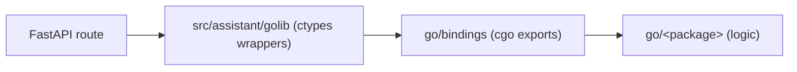

# Go backend code

The API stays in Python. Backend logic can be written in Go and called
in-process: the module in `go/` is built with `-buildmode=c-shared` into
`libassistant_go.so`, a C shared library that `assistant.golib` loads with
`ctypes`. See [ADR-0006](../adr/0006-go-shared-library.md) for why.

## Calling convention

Every export except `AssistantFree` follows one convention, so the Python side
needs a single marshalling helper (`call_string` in `golib/_library.py`):

- Strings go in as a pointer and a byte length, so they may hold NUL bytes.
- The function returns 0 on success and 1 on error. Either way it writes a
  malloc'd buffer to `*out` and its length to `*outLen`: the result, or the
  error message.
- Python copies the buffer and releases it with `AssistantFree`. Go memory
  never crosses the boundary, which cgo's pointer rules forbid anyway.
- An error becomes `GoLibraryError`, a `ValueError`.

## Adding a Go function

1. Write the logic in a package under `go/`, free of cgo, with a `_test.go`
   file next to it.
2. Export it in `go/bindings/main.go`: an `//export Assistant<Name>` function
   that converts arguments and wraps the logic in `call`, which also recovers
   panics.
3. Add the name to `_STRING_FUNCTIONS` in `src/assistant/golib/_library.py`,
   and a typed wrapper in `src/assistant/golib/__init__.py`. The `ctypes`
   signatures are the only contract, and nothing checks them against the Go
   exports, so cover each wrapper with a test that calls the real library.
4. Call it from a service, or from a route for logic with no data access.

`go/greeting`, `assistant.golib.greet` and `GET /gocore/greeting` are the worked
example. A function with other argument or result types needs its own
convention in `_library.py`; prefer passing JSON as a string over a C struct.

## Constraints

- **Panics.** `call` recovers a panic on the calling goroutine and reports it
  as an error. A panic on any other goroutine cannot be recovered and kills the
  whole API process, so every goroutine an export starts must recover its own
  panics.
- **Event loop.** `ctypes.CDLL` releases the GIL during a call, but the call
  still blocks its thread. Call Go from `def` route handlers, or through
  `run_in_threadpool` in `async def` ones.
- **Forks.** The Go runtime starts threads when the library loads, and they do
  not survive a `fork`. `golib` loads the library on the first call, so load it
  only after any fork (uvicorn's workers use spawn, which is safe).
- **One runtime.** The process can hold only one Go runtime, so keep all Go
  code in this one library rather than building several.

## Building

Development needs Go at the version in `go/go.mod` and a C compiler for cgo.
`make go-build` builds `src/assistant/golib/libassistant_go.so` (and the cgo
header next to it, both ignored by git) and reruns only when a Go source
changed. `make test`, `make server` and `make dev` run it first; bare `pytest`
and `uv run` do not. The file is named `.so` on macOS too, so Python finds it by
one name.

`make go-check` runs `gofmt`, `go vet` and the Go tests.

The Docker image builds the library in a `go-builder` stage and copies it into
the final stage, which carries no toolchain. cgo links the library against
glibc, so the builder's Debian release must not be newer than the Python
image's. The Dockerfile then calls the library, so a broken build fails the
image, and the CI `docker` job runs that build.
