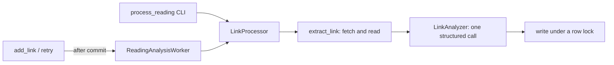

# Reading list

Users save links to read or watch later. The AI files each link under one of
the user's [categories](categories.md) and writes a short summary, in the
background. The behaviour is in the [spec](../specs/0009-reading-list.md).
Code: `src/assistant/reading/`.

Nothing is shared: links have an `owner_id`, and a service function loads the
row filtered by owner, so another user's link is a 404. There are no
entitlements.

## Storage

`reading_links`, one row per saved link. The content is never stored, only
what the analysis derived from it.

| Column | Content |
| --- | --- |
| `url`, `url_key` | The URL with tracking parameters dropped, and its identity, unique per owner. |
| `title`, `title_edited` | The title, and whether the user wrote it. |
| `link_type` | `web`, `pdf`, `text`, `youtube` or `other`. Null until analyzed. |
| `category_id`, `category_set_by_user` | The category (`SET NULL` when it goes), and whether the user chose it. |
| `summary`, `user_notes` | The model's summary; the user's own scratchpad, never copied anywhere. |
| `analysis_status`, `attempts`, `last_error` | The pipeline: `pending`, `done`, `not_summarizable` or `failed`. The error is generic. |
| `state`, `decided_at` | The user's decision: `to_read`, `discarded` or `promoted`, and when it was made. |
| `note_id` | The note a promoted link went to (`SET NULL` when the note is deleted: the link stays promoted). |

Deleting a user cascades to their links.

## URL identity

`reading/service.py`. `url_key` is the SHA-256 of the lowercase host (with a
non-default port) and the path and query normalized as for blog posts
(`web/urls.py`): tracking parameters (`utm_*`, `fbclid`, ...), the order
of the other parameters, a trailing slash and the fragment don't count, nor
does the scheme. Unlike a post key it keeps the host, since links come from
many sites. Saving a URL whose key the user already has, in any state, is
refused with the existing link's id.

## States

| Action | From | To |
| --- | --- | --- |
| Discard | `to_read` | `discarded`, `decided_at` set |
| Restore | `discarded` | `to_read`, `decided_at` cleared |
| Delete | `discarded`, `promoted` | gone |

Anything else is a 409. Lists are paged by keyset: To read by `created_at`,
oldest first; Archive and Promoted by `decided_at`, newest first. Links leave
a view as the user decides on them, and an offset would skip the next ones.

## Analysis



**When.** `add_link` and `retry_analysis` call `queue_for_analysis`. The ids
are kept on the session and handed to the listener after the commit, like
stale notes for the [vector worker](vectors.md); a rollback forgets them. The
API registers a `ReadingAnalysisWorker` (one daemon thread) when AI is
enabled. Without it links stay `pending`, and
`python -m assistant.cli.process_reading [--user-id] [--link-id]` (or
`make process-reading`) analyzes whatever is pending: links saved while AI was
off, or left when the server stopped. The CLI tries each link until it is no
longer pending and exits with 1 if any failed.

**Fetching and reading** (`reading/extraction.py`) goes through the shared
`assistant/web/` package: the safe fetcher (`web/fetch.py`, see
[Blogs](blogs.md#safe-fetcher)) and page extraction (`web/pages.py`), with
25 MB and 30 s per link instead of 5 MB and 10 s, because of PDFs.

| Type | Decided by | What is read |
| --- | --- | --- |
| `youtube` | the host, before any fetch (`youtube.com`, `www.`, `m.`, `youtu.be`) | oEmbed title and channel, through the safe fetcher. No oEmbed answer: the URL alone |
| `web` | `text/html`, `application/xhtml+xml` | `trafilatura` main text and title, as for blog posts |
| `text` | `text/plain`, `text/markdown` | the body, decoded with its charset |
| `pdf` | `application/pdf`, or `%PDF-` in an unnamed binary | `pypdf`: metadata title (else the first line), pages in order until 20 000 characters, then it stops |
| `other` | anything else | nothing |

An encrypted PDF that needs a password, or one `pypdf` can't parse, is an
`ExtractionError`. A PDF locked only against editing opens with an empty
password.

**The model call** (`reading/analysis.py`) is one
`with_structured_output(LinkAnalysis)` on `ai.blog_model`, with no tools,
because link text is untrusted. It gets the URL, type, title, channel, the
text cut at 20 000 characters (only for `web`, `pdf` and `text` with at least
200 characters), and the user's categories as `c1: name: description` lines.
Short ids are copied back more reliably than UUIDs; an id not in the list is
no category. A partial PDF is summarized from its abstract and introduction.
With no text the summary is always null and the link is `not_summarizable`.
Runs are traced in LangSmith, named and tagged `reading_process`, with
`link_id` metadata.

**Writing.** No transaction stays open across the fetch or the model call. The
processor reads the link and the categories, works, then reloads the row with
`FOR UPDATE` and gives up if it is gone or no longer `pending`. Then:

- the title is the link's own, else the model's, unless `title_edited`;
- the category is the model's choice, unless `category_set_by_user` (the user
  chose it, before or while the model ran) or the category was deleted
  meanwhile.

**Failures.** Any failure increments `attempts` and stores a generic
`last_error` (a fetch or extraction message, or `Could not analyze
(<exception class>)`), is logged and goes to Sentry. Below 3 attempts the link
stays `pending` and the worker queues it again after 30 s, then 120 s. At 3
it is `failed`: no summary, and Unfiled unless the user chose a category.
Retries waiting at shutdown are dropped; the links stay pending for the CLI.

**Retry** (`POST /reading/link/{id}/retry`), from any state, resets the link
to `pending` with `attempts = 0`. What the user chose still wins: a title
they edited and a category they set (Unfiled included) are kept, so only a
link the AI filed is filed again, after the user edited category
descriptions, say. To let the AI file a link again, it would need a "reset"
the UI doesn't offer.

## Configuration

```yaml
ai:
  blog_model: openai:gpt-6-luna  # AI_BLOG_MODEL, also used for links

reading:
  summary_words: 100  # READING_SUMMARY_WORDS
```
