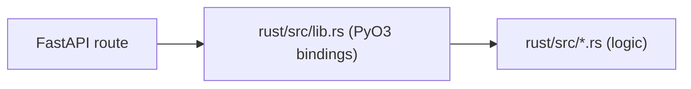

# Rust backend code

The API stays in Python. Backend logic can be written in Rust and called
in-process: the crate in `rust/` is a Python extension module, `assistant_rust`,
built with [PyO3](https://pyo3.rs) and [maturin](https://www.maturin.rs). See
[ADR-0005](../adr/0005-rust-python-extension.md) for why.

The crate is a uv workspace member and a dependency of the `assistant` package,
so `uv sync` compiles it into `.venv` and imports work like any other package.

## Adding a Rust function

1. Write the logic in a module under `rust/src/`, free of PyO3 types, with a
   `#[cfg(test)]` module.
2. Bind it in `rust/src/lib.rs`: a `#[pyfunction]` that converts arguments and
   errors, registered in the `#[pymodule]`. Wrap slow work in `py.detach` so it
   releases the GIL.
3. Add its signature to `rust/assistant_rust.pyi`. This stub is the only thing
   mypy sees, and nothing checks it against the bindings.
4. Call it from a service, or from a route for logic with no data access.

`rust/src/greeting.rs` and `GET /rustcore/greeting` are the worked example.

## Constraints

- **Panics.** PyO3 turns a panic on the calling thread into a
  `pyo3_runtime.PanicException`, and the request fails with a 500 while the
  server keeps running. The exception derives from `BaseException`, so
  `except Exception` and FastAPI's exception handlers do not see it: report
  expected failures as `PyResult` errors. Unwinding is required, so leave
  `panic = "abort"` out of the Cargo profiles.
- **Event loop.** A call blocks its thread. Call Rust from `def` route handlers,
  or through `run_in_threadpool` in `async def` ones.
- **Forks.** Plain Rust code has no runtime and is safe across a `fork`. A
  background runtime such as Tokio is not, so start one after the fork.

## Building

Development needs Rust; `rust/rust-toolchain.toml` pins the version and rustup
installs it on first use. `make rust-build` runs `uv sync`, which rebuilds the
extension only when the files in `cache-keys` of `rust/pyproject.toml` changed.
`make test`, `make server` and `make dev` run it first; `uv run` does the same.

The extension targets the stable ABI (`abi3-py313`), so one build works on
every Python from 3.13 on.

The Docker image builds a wheel in a `rust-builder` stage and installs it in the
final stage, which carries no toolchain. The Dockerfile then calls the extension,
so a broken build fails the image, and the CI `docker` job runs that build.
