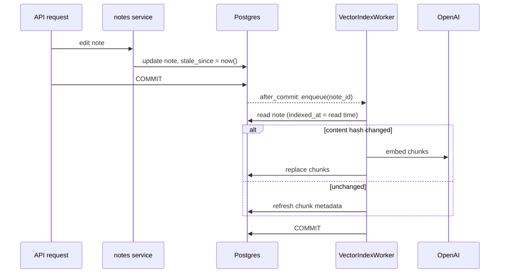

# Vector search

Notes are embedded into pgvector so the Ask AI agent can find the parts of
the notes that answer a question. The why is in
[ADR-0003](../adr/0003-pgvector-note-embeddings.md); this page is the how.
Code: `src/assistant/vectors/`.

## Storage

| Table | Mapped | Content |
| --- | --- | --- |
| `note_chunk_embedding` | no (Postgres-only, pgvector) | One row per chunk: `langchain_id`, `content` (the embedded text), `embedding vector(1536)`, `note_id`, `notebook_id`, `chunk_index`, `langchain_metadata` (JSONB). HNSW cosine index. |
| `note_vector_index` | yes (`NoteVectorIndex`) | One row per indexed note: `content_hash`, `index_version`, `indexed_at`, `stale_since`. |

Both are deleted with their note (ON DELETE CASCADE). `store.py` describes
the chunk table as a standalone SQLAlchemy Core `Table`; Alembic
autogenerate ignores it (`_UNMAPPED_TABLES` in `models/database.py`).

## From note to chunks

1. `markdown.note_markdown` joins the note's blocks in order. Markdown
   blocks are kept as they are, attachments become their file name, and
   consecutive list items stay one list.
2. `chunking.chunk_note` splits by `#`/`##`/`###` headings, then each
   section into chunks of at most 1000 characters overlapping by 200.
3. Every chunk's text starts with a header, which is embedded and stored
   with it:

   ```
   Title: Rome trip
   Notebook: Travel
   Section: Day 2 > Food

   Carbonara at Roscioli...
   ```

4. Metadata, in `langchain_metadata`: `title`, `notebook_name`,
   `created_at`, `updated_at`, `chunk_index`, `index_version`, `section`.
   `note_id` and `notebook_id` are real columns so they can be filtered
   and indexed. New keys can be added freely (bump the index version to
   backfill them).

Tags are not in the metadata on purpose: tags are per user, and a shared
note's chunks would show the owner's tag names to everyone it is shared
with.

## Keeping embeddings fresh



- `staleness.mark_notes_stale` is called by `create_note`, `_touch_note`
  (every note write) and, for all its notes, a notebook rename. It sets
  `stale_since` and remembers the ids on the session.
- An `after_commit` session event hands those ids to the registered
  listener: the `VectorIndexWorker` started by the API lifespan when AI is
  enabled. A rollback drops them.
- A note is stale when it has no `note_vector_index` row, `indexed_at` is
  null, `index_version < VECTOR_INDEX_VERSION`, or `stale_since >
  indexed_at` (`staleness.stale_note_ids`). The indexer stores the time it
  *read* the note as `indexed_at`, so an edit committed while it was
  calling the model leaves the note stale (and that edit's commit queued
  it again).
- The worker runs one job at a time on a daemon thread. A note already
  queued is not queued twice. Failures (no credits, rate limits, network)
  are logged as warnings with the exception and sent to Sentry, then
  ignored: the note stays stale.
- `content_hash` covers the embedding model name and every chunk text, so
  an unchanged note costs no model call, and a model change re-embeds.

## Retrieval

The Ask AI agent searches the chunks with `vectors/search.NoteSearcher`, a
langchain `PGVectorStore` over the same table (cosine distance), filtered
to the notes the asking user can view. See [Ask AI](ask.md#permissions-in-semantic-search).

## Reindexing

```bash
# Embed notes that are missing or outdated (needs OPENAI_API_KEY)
make reindex-vectors
# Everything, or one user's notes
python -m assistant.cli.reindex_search --vectors [--user-id UID]
```

Run it after the migration that adds the tables, after bumping
`VECTOR_INDEX_VERSION` (any change to rendering, chunking or metadata), and
to retry notes whose embedding failed or that were written by a process
without a worker (e.g. `cli.import_html_notes`). Each note is embedded in
its own transaction; failures are logged and the command exits with 1.

## Configuration

```yaml
ai:
  embedding_model: text-embedding-3-small  # AI_EMBEDDING_MODEL
```

AI features are on exactly when `OPENAI_API_KEY` is set. Without it no
worker starts, nothing is embedded and notes simply stay stale. A model
with a dimension other than 1536 needs a migration of the `embedding`
column.
